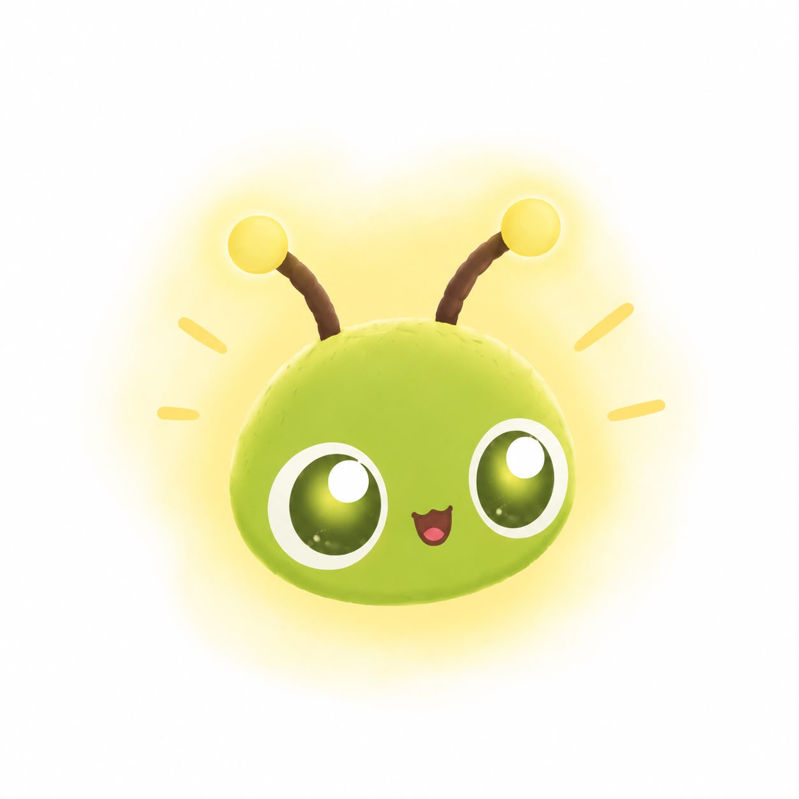
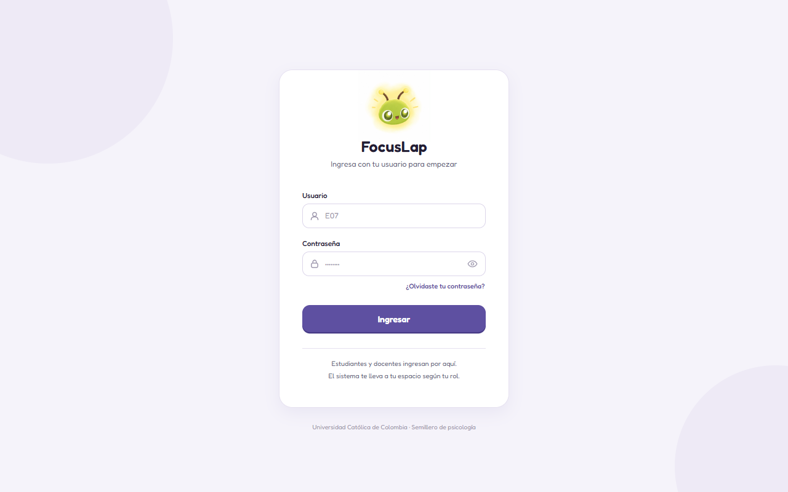
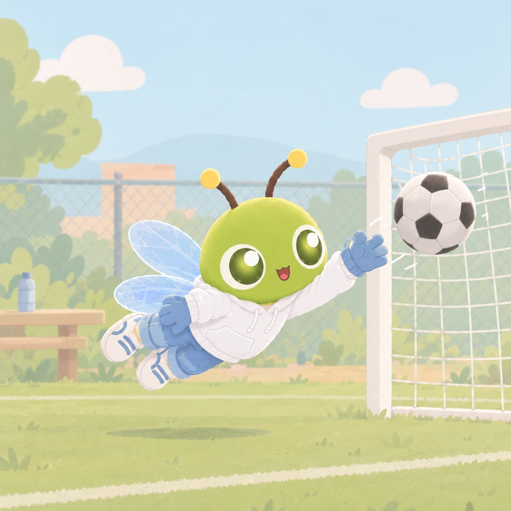
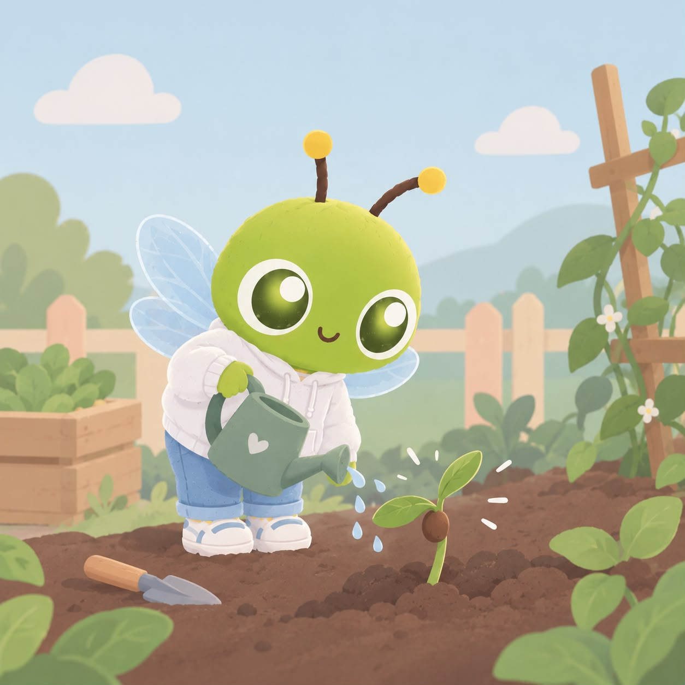
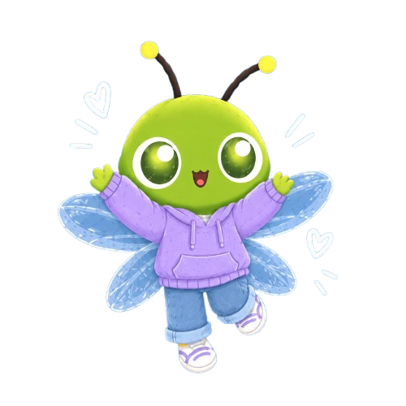
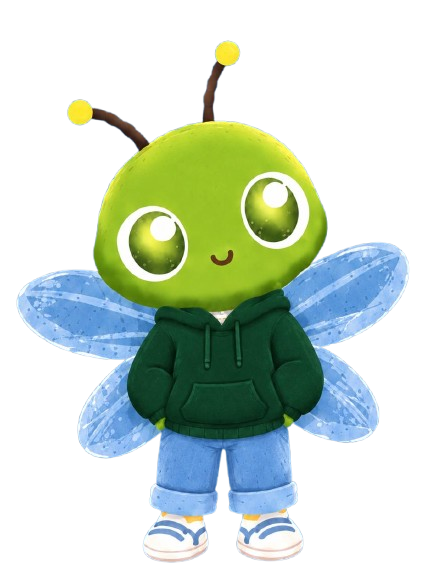

<div align="center">



# FocusLap

**Lee, juega y entrena tu atención.**
Una página web para que niños de 10 a 13 años practiquen la concentración mientras leen.

### [▶ Abrir FocusLap](https://focuslap-e8e7a.web.app)

https://focuslap-e8e7a.web.app

</div>



## Sobre el proyecto

FocusLap es mi proyecto de grado de **Ingeniería de Sistemas y Computación** en la **Universidad Católica de Colombia**:

> *Prototipo de espacio digital modular en la web basado en principios de psicología cognitiva para estimular la concentración académica de los estudiantes entre los 10 y los 13 años.*

A muchos niños les cuesta quedarse concentrados en una lectura, y quería hacer algo que se sintiera más como un juego que como una tarea. En FocusLap leen cuentos cortos, responden preguntas, ganan puntos, desbloquean juegos de atención y cuidan a una mascota que los acompaña.

El piloto se realiza con un salón de un colegio de Bogotá durante **3 días**.

## Características

- 📖 **Lectura guiada:** dos cuentos con preguntas que cambian cada día según el componente de atención que se trabaja.
- ⭐ **Puntos que motivan:** cada respuesta correcta suma 10 puntos, hasta 160 en total. Los puntos nunca se pierden.
- 🎮 **Seis juegos de atención** que se desbloquean con los puntos y se pueden jugar las veces que se quiera.
- 🐛 **Una mascota propia:** una luciérnaga que tiene frío al comenzar el día y recupera el calor cuando el niño termina su primer cuento.
- 🎨 **Personalización:** cada niño elige el color de su página y el buzo de su mascota.
- 👩‍🏫 **Panel para la docente** con el avance de cada estudiante.
- 📊 **Tablero para la investigadora** con gráficas por componente de atención y descarga de datos en CSV.
- 📶 **Funciona sin internet:** lo que el niño hace se guarda en el equipo y se sincroniza solo cuando vuelve la conexión.
- 🔒 **Anónimo:** cada niño entra con un código (E01 a E28). Nunca se guardan ni se muestran nombres reales.

## Cómo funciona

Cada día el niño lee los mismos dos cuentos, pero las preguntas cambian para trabajar una habilidad distinta:

| Día | Componente de atención | Preguntas por cuento | Puntos del día |
| --- | --- | --- | --- |
| 1 | Encontrar el tema y la idea principal | 2 | 40 |
| 2 | Fijarse en las pistas que deja el autor | 3 | 60 |
| 3 | Aprender a resumir | 3 | 60 |

La página sabe sola en qué día va cada niño según el calendario del piloto, sin botones para cambiar de día.

### Los cuentos

<table>
  <tr>
    <td align="center"><br /><b>El último penalti</b></td>
    <td align="center"><br /><b>La huerta del salón</b></td>
  </tr>
</table>

## Los juegos

Los juegos se abren a medida que el niño suma puntos leyendo. Jugar no da puntos, para que la lectura siga siendo lo principal.

| Juego | Habilidad | Se desbloquea con | Qué mide |
| --- | --- | --- | --- |
| **A Todo Foco** | Atención sostenida | 20 puntos | X tocadas, X que se escaparon, toques en otra letra, tiempo de reacción |
| **Repite el Patrón** | Memoria de trabajo | 40 puntos | secuencia más larga, aciertos, errores |
| **Sigue el Punto** | Seguimiento visual | 70 puntos | rondas acertadas, tiempo de respuesta |
| **Encuentra el Par** | Atención selectiva | 100 puntos | rondas acertadas, toques errados, tiempo por ronda |
| **Semáforo Atento** | Atención e inhibición | 130 puntos | verdes tocadas, verdes que se escaparon, rojas tocadas, tiempo de reacción |
| **Caza Figuras** | Atención selectiva | 160 puntos | estrellas encontradas, estrellas sin encontrar, figuras equivocadas, tiempo total |

Mientras se juega no aparece la mascota ni nada que distraiga.

## La mascota

Una luciérnaga que diseñé para FocusLap. Cada día empieza con frío y se calienta cuando el niño termina su primer cuento. Se le puede poner nombre y cambiar el buzo entre lila, rosa, negro y verde.

<table>
  <tr>
    <td align="center"><br />Al empezar el día</td>
    <td align="center"><br />Después del primer cuento</td>
    <td align="center"><br />Con otro buzo</td>
  </tr>
</table>

## Docente e investigadora

Hay tres tipos de usuario, y al iniciar sesión la página lleva a cada uno a su espacio.

- **Docente:** ve en qué día va cada estudiante, cuántos cuentos ha terminado, cuánto se demora leyendo y cuántas preguntas acierta al primer intento.
- **Investigadora:** tiene un tablero con gráficas por componente de atención y por día, el detalle de cada estudiante y la descarga de los datos en CSV (respuestas, lecturas y juegos).

Ningún panel muestra rankings ni comparaciones entre niños, y los datos aparecen siempre con el código del estudiante, nunca con su nombre.

## Sin internet

Como en los colegios el internet a veces falla, la página sigue funcionando sin conexión. Lo que el niño haga se guarda en el equipo y se sube solo cuando vuelve el internet.

## Tecnologías

- [React 18](https://react.dev/) y [Vite](https://vite.dev/)
- [React Router](https://reactrouter.com/) para la navegación
- [Firebase](https://firebase.google.com/): Authentication, Cloud Firestore con caché sin conexión y Hosting
- [vite-plugin-pwa](https://vite-pwa-org.netlify.app/) para que la página funcione sin internet
- [Vitest](https://vitest.dev/) para las pruebas automáticas
- Fuente Fredoka y cuatro temas de color hechos con variables CSS

El código sigue una **arquitectura basada en componentes**: cada módulo (lectura, preguntas, juegos, mascota, progreso, paneles) vive en su propia carpeta dentro de `src/features/`.

```
src/
  app/          rutas y estructura general
  auth/         inicio de sesión y roles
  features/     un módulo por funcionalidad
  data/         cuentos y preguntas
  services/     conexión con Firebase
  styles/       estilos generales
  theme/        temas de color
  assets/       mascota, portadas e íconos
```

## Autora

Hecho con mucho cariño por **Sharick Natalia Hernández Gómez**, Universidad Católica de Colombia.

Espero que te guste mi página tanto como a mí me gustó hacerla. Ojalá algún día ideas como esta ayuden a que los niños aprendan de una forma más bonita y que la tecnología sea una aliada en su educación y no una distracción :)
